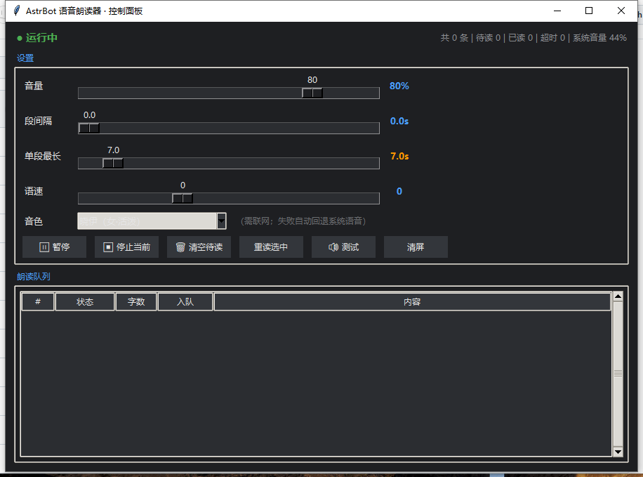

# astrbot-voice-reader

将 AstrBot 的文本回复通过本机扬声器实时朗读出来的辅助工具。

本项目定位为**语音播放调度器**，不包含任何语音合成模型。其职责是从 AstrBot 的会话数据库中读取助手回复，进行文本清洗与断句，调用外部语音合成服务生成音频，并通过系统音频设备播放。

---

## 重要说明：语音来源

本项目自身不提供语音合成能力。所有音频均由以下第三方服务或系统组件生成：

| 来源 | 说明 |
|---|---|
| Microsoft Edge 在线语音服务 | 通过开源库 [edge-tts](https://github.com/rany2/edge-tts) 调用，提供神经网络语音合成 |
| Windows SAPI | 操作系统内置语音合成接口，作为离线回退方案 |

使用本项目前，请确认您的使用场景符合微软相应的服务条款。本项目仅负责调用与播放，不对合成结果及服务可用性作出保证。

---

## 功能概述

| 功能 | 说明 |
|---|---|
| 自动朗读 | 以固定间隔轮询 AstrBot 数据库，检测到新的助手回复后自动朗读 |
| 单轮聚焦 | 仅朗读与最新用户提问对应的一轮回复，新对话到达时旧队列自动作废 |
| 整句断句 | 按标点切分句子，达到时长上限时停在句子边界，避免截断于词语中间 |
| 并行预合成 | 多个句子并发请求语音合成，降低首句播放延迟 |
| 播放控制 | 支持暂停、跳过、清空队列、重复朗读 |
| 快捷中断 | 通过全局快捷键立即终止当前播放 |
| 可视化面板 | 提供音量、间隔、时长、语速、音色及队列状态的图形界面 |
| 音色管理 | 支持动态获取音色列表、本地缓存与自定义音色配置 |

---

## 系统要求

- 操作系统：Windows 10 或 Windows 11
- Python：3.9 及以上版本
- 运行环境：已部署并运行的 AstrBot 实例
- 网络：使用 Edge 语音合成时需可访问互联网；离线场景可切换至系统语音

---

## 安装

```bash
git clone https://github.com/manfupu4-code/astrbot-voice-reader.git
cd astrbot-voice-reader
```

推荐直接双击 `start.bat`，脚本会自动创建虚拟环境并安装依赖。

手动安装方式如下：

```bash
python -m venv .venv
.venv\Scripts\activate
pip install -r requirements.txt
```

安装完成后可执行自检命令，确认音频链路正常：

```bash
python -m voice_reader.main --test
```

若能够听到测试语音，表示环境配置成功。

---

## 使用方法

```bash
python -m voice_reader.main                    # 默认启动，带图形界面
python -m voice_reader.main --no-gui           # 无界面后台运行
python -m voice_reader.main --list-voices      # 列出可用音色
python -m voice_reader.main --volume 50        # 指定系统音量
```

### 命令行参数

| 参数 | 说明 |
|---|---|
| `--db` | 指定 `data_v4.db` 文件路径；未指定时自动查找 |
| `--voice` | 指定音色 ID；传入空字符串表示使用系统语音 |
| `--volume` | 设置系统主音量，取值范围 0–100 |
| `--no-gui` | 不启动图形界面，仅后台运行 |
| `--list-voices` | 输出可用音色列表 |
| `--refresh-voices` | 联网刷新音色目录，需与 `--list-voices` 配合使用 |
| `--test` | 播放一条测试语音后退出 |
| `--version` | 显示版本信息 |

---

## 控制面板



| 控件 | 功能说明 |
|---|---|
| 音量 | 调整 Windows 系统主音量，影响所有音频输出 |
| 段间隔 | 设置上一段朗读结束后至下一段开始的等待时长；设为 0 表示连续朗读 |
| 单段最长 | 单段文本的最大朗读时长，超限时在句子边界停止，状态标记为「超时截断」 |
| 语速 | 系统语音以 −5 至 10 档表示；Edge 语音自动换算为百分比 |
| 音色 | 下拉选择音色，或点击「刷新音色」联网获取完整列表 |

队列区域实时显示每条文本的处理状态，包括待读、朗读中、已读、超时截断、已停止与已取消。

所有设置修改后立即写入 `config.json`，并自动保存。

---

## 音色管理

音色配置不硬编码于源代码中，采用三级策略：

1. **内置列表**：包含 10 个常用中文音色，离线状态下可用作兜底。
2. **在线目录**：通过「刷新音色」按钮或 `--list-voices --refresh-voices` 命令获取完整音色列表，当前共 322 个音色，其中中文音色 14 个（含普通话、粤语、台湾地区口音、东北话与陕西话）。目录缓存有效期为 7 天。
3. **自定义配置**：可在 `config.json` 的 `custom_voices` 字段中追加自定义条目：

```json
"custom_voices": [
  { "id": "zh-CN-XiaoxiaoNeural", "label": "常用音色", "locale": "zh-CN" }
]
```

将 `voice` 字段设为空字符串即可切换至 Windows 系统语音，实现完全离线运行。

---

## 工作原理

```
data_v4.db（只读模式）
    │  每 0.4 秒轮询一次
    ▼
检测到新的助手回复
    │  等待 1.5 秒静默期，确认写入完成
    ▼
按空行切分为段落
    │  清洗 Markdown 标记、代码块、表情符号
    ▼
按标点切分为句子（避免截断于词语中间）
    │
    ├─ 4 线程并行语音合成
    ▼
播放队列 ──► 播放线程 ──► 系统扬声器
```

### 关键设计

- **数据库只读访问**：以 `mode=ro` 打开，不执行任何写入操作，确保不影响 AstrBot 正常运行。
- **时长计量方式**：超时判定仅累计实际播放时长，不包含网络合成等待时间。
- **缓存并发安全**：采用文件锁、临时文件与原子替换（`os.replace`）机制，避免并发读取到不完整的音频文件。
- **静默判定**：AstrBot 可能分多次写入同一轮回复，检测到新增内容后等待 1.5 秒静默期再入队，避免朗读过程中被重复打断。
- **看门狗机制**：每 2 秒巡检播放状态，若单段朗读超出上限加 25 秒仍未结束，则强制中断，防止线程阻塞。
- **异常回退**：语音引擎初始化失败时自动降级至系统语音；合成超时或缓存损坏时自动重试或跳过。

---

## 配置文件

首次运行时自动生成 `config.json`：

```json
{
  "db_path": "",
  "voice": "zh-CN-XiaoyiNeural",
  "custom_voices": [],
  "volume": 80,
  "gap": 0.0,
  "max_sec": 7.0,
  "rate": 0,
  "only_latest_turn": true,
  "hotkey": "shift+win+e",
  "poll_interval": 0.4,
  "log_max_mb": 5
}
```

| 字段 | 说明 |
|---|---|
| `db_path` | 数据库路径，留空则自动查找 |
| `voice` | 音色 ID，空字符串表示使用系统语音 |
| `custom_voices` | 自定义音色列表 |
| `volume` | 系统主音量 |
| `gap` | 段间隔（秒） |
| `max_sec` | 单段最长朗读时长（秒） |
| `rate` | 语速档位 |
| `only_latest_turn` | 是否仅朗读最新一轮对话 |
| `hotkey` | 中断快捷键，支持 `shift`、`ctrl`、`alt`、`win` 与字母或功能键组合 |
| `poll_interval` | 数据库轮询间隔（秒） |
| `log_max_mb` | 日志文件大小上限，超出后自动轮转 |

---

## 已知限制

1. **平台限制**：仅支持 Windows。系统语音、全局快捷键与音量控制均依赖 Win32 API。
2. **非流式朗读**：AstrBot 的会话数据在整轮生成完成后写入数据库，因此本项目无法实现逐句流式朗读，必须先等待整段回复生成完毕。
3. **网络依赖**：Edge 语音合成需要联网。网络不可用时会回退至系统语音，音质明显下降。
4. **数据延迟**：数据库写入时机由 AstrBot 控制，检测到新回复可能存在数秒延迟。
5. **外放风险**：朗读内容通过扬声器输出，请注意使用环境。

---

## 常见问题

**Q：启动后没有声音？**
A：先执行 `--test` 进行自检。若自检有声，说明问题在于数据库读取，请检查 `--db` 参数是否正确；若自检无声，请检查系统音量与默认播放设备。

**Q：朗读被中途截断？**
A：「单段最长」设置生效。可调大该值，或将回复内容拆分为更短的段落。

**Q：提示找不到数据库？**
A：可通过 `--db` 参数指定路径，或设置环境变量 `ASTRBOT_DB`。

**Q：能否朗读历史记录？**
A：默认不朗读历史。程序启动时会将读取指针定位至会话末尾。

**Q：启动时提示「已经有一个朗读器在运行」？**
A：本项目通过命名互斥量限制为单实例运行，避免多个进程并发读写 `state.json` 导致漏读。请先在任务管理器中结束原有的 `python.exe` 进程，再重新启动。

**Q：断网后还能使用吗？**
A：可以。将 `voice` 设为空字符串，程序会使用 Windows 系统语音，全程离线运行。

---

## 依赖与致谢

| 组件 | 项目 | 用途 | 许可证 |
|---|---|---|---|
| 语音合成（默认） | [edge-tts](https://github.com/rany2/edge-tts) | 调用微软在线语音服务 | MIT |
| 语音合成（离线） | Windows SAPI | 系统内置语音合成 | 随操作系统 |
| 音频播放 | [pygame](https://github.com/pygame/pygame) | 播放 MP3 音频 | LGPL |
| 音量控制 | [pycaw](https://github.com/AndreMiras/pycaw) | 调用 Windows Core Audio API | MIT |
| COM 接口调用 | [comtypes](https://github.com/enthought/comtypes)、[pywin32](https://github.com/mhammond/pywin32) | 访问系统语音组件 | MIT、PSF |

再次说明：`edge-tts` 本身为 MIT 开源项目，但其调用的语音服务属于微软资产，使用前请自行确认合规性。

---

## 许可证

本项目采用 MIT 许可证，详见 [LICENSE](LICENSE)。
